# คู่มือใช้งานระบบตรวจสอบชั่วโมง TA

ระบบให้นักศึกษา TA ล็อกอินด้วยรหัส OTP ทางอีเมล @cmu.ac.th แล้วดูชั่วโมงของตนเอง **กดยืนยัน** หรือ **รายงาน** ว่าไม่ถูกต้อง ส่วนเจ้าหน้าที่ดูสถานะของนักศึกษาทุกคนและรับแจ้งเตือนเมื่อมีรายงาน

> ภาพหน้าจอในคู่มือใช้ **ข้อมูลสมมติ** (ชื่อ รหัส และอีเมลไม่ใช่ของจริง)
> **วงสีส้มที่มีตัวเลข** คือจุดที่กรอกหรือกดได้ เลขตรงกับคำอธิบายใต้ภาพ

**ระบบนี้ใช้ได้ทั้งมือถือและคอมพิวเตอร์ ไม่ต้องสมัครสมาชิกหรือตั้งรหัสผ่าน**

---

## ส่วนที่ 1 สำหรับนักศึกษา TA

### ขั้นที่ 1 เปิดลิงก์และกรอกอีเมล

เปิดลิงก์ที่เจ้าหน้าที่ส่งให้ จะพบหน้าเข้าสู่ระบบ จุดที่ **กรอกได้ตั้งแต่แรก** คือช่องอีเมลช่องเดียว

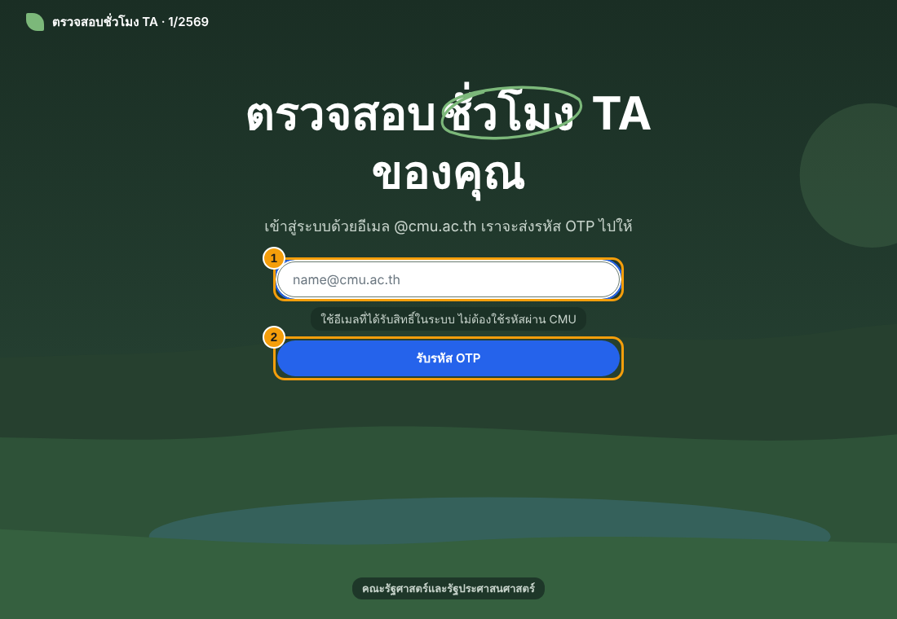

| เลข | ทำอะไรได้ |
|---|---|
| ① | **ช่องอีเมล (กรอกได้)** ใส่อีเมลมหาวิทยาลัยของคุณ `...@cmu.ac.th` ต้องเป็นอีเมลที่ลงทะเบียนไว้กับเจ้าหน้าที่ |
| ② | **ปุ่ม "รับรหัส OTP"** (กดได้) ระบบส่งรหัส 6 หลักไปที่อีเมล |

ใช้อีเมลของตนเองเท่านั้น หากอีเมลไม่อยู่ในรายชื่อ ระบบจะไม่ส่งรหัสให้ (และไม่แจ้งว่าอีเมลนั้นมีหรือไม่มีในระบบ) ให้ติดต่อเจ้าหน้าที่

### ขั้นที่ 2 เปิดอีเมลและดูรหัส OTP

ตรวจกล่องจดหมายของคุณ จะได้อีเมลหน้าตาแบบนี้ ภายในประมาณ 1–2 นาที

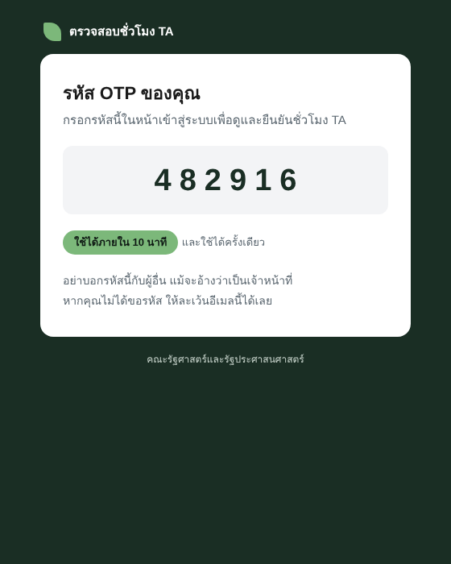

- รหัสเป็นตัวเลข 6 หลัก **ใช้ได้ 10 นาที และใช้ได้ครั้งเดียว**
- ถ้าไม่เจอ ให้ดูในโฟลเดอร์ Junk/Spam หรือค้นหาชื่อผู้ส่ง "ระบบตรวจสอบชั่วโมง TA"
- **อย่าบอกรหัสนี้กับใคร** เจ้าหน้าที่จะไม่ขอรหัส OTP ทางโทรศัพท์หรือแชท

### ขั้นที่ 3 กรอกรหัส OTP

กลับมาที่หน้าเว็บ หน้าจอเปลี่ยนเป็นหน้ากรอกรหัสโดยอัตโนมัติ

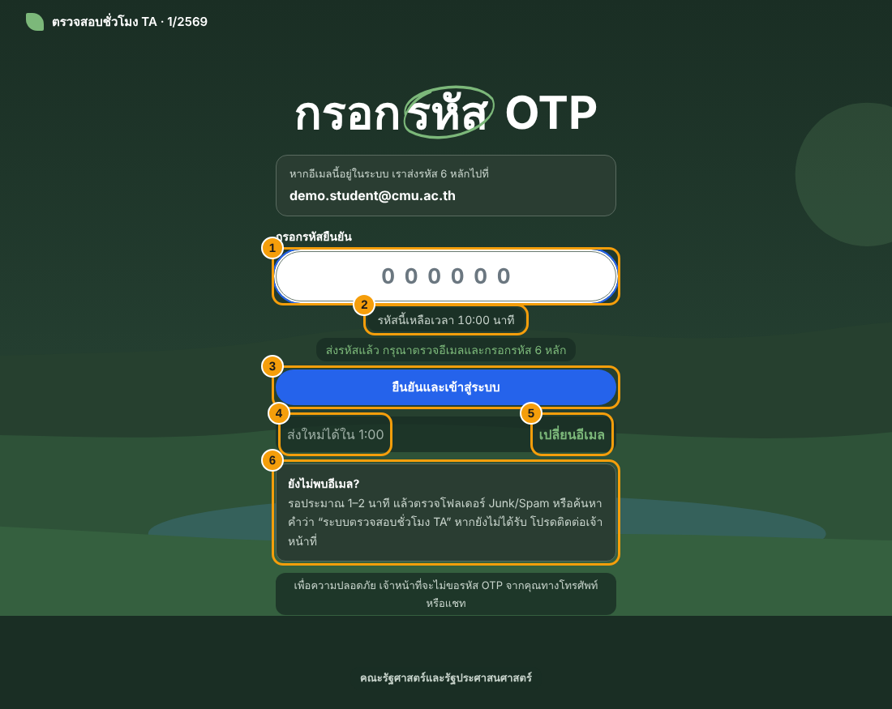

| เลข | ทำอะไรได้ |
|---|---|
| ① | **ช่องรหัส 6 หลัก (กรอกได้)** พิมพ์ตัวเลขจากอีเมล (กรอกได้เฉพาะตัวเลข) |
| ② | **เวลานับถอยหลัง** (ดูอย่างเดียว) บอกเวลาที่รหัสเหลือ เมื่อหมดเวลาปุ่มยืนยันจะกดไม่ได้ |
| ③ | **ปุ่ม "ยืนยันและเข้าสู่ระบบ"** (กดได้) |
| ④ | **ปุ่ม "ส่งรหัสใหม่"** (กดได้เมื่อหมดเวลารอ 1 นาที) ใช้เมื่อไม่ได้รับอีเมลหรือรหัสหมดอายุ **ให้ใช้รหัสล่าสุดเท่านั้น** |
| ⑤ | **ปุ่ม "เปลี่ยนอีเมล"** (กดได้) กลับไปหน้าแรกเพื่อกรอกอีเมลใหม่ |
| ⑥ | **กล่องช่วยเหลือ** (ดูอย่างเดียว) วิธีหาอีเมลที่ยังไม่มา |

**ถ้ากรอกรหัสผิด** จะขึ้นข้อความสีแดงแล้วลองใหม่ได้ (กรอกผิดได้ไม่เกิน 5 ครั้ง ถ้าเกินต้องขอรหัสใหม่)

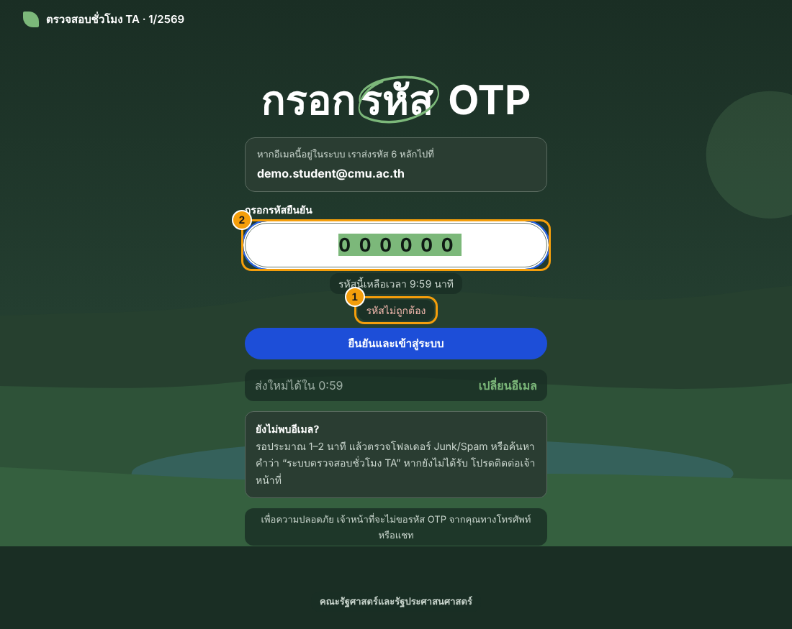

### ขั้นที่ 4 ตรวจชั่วโมงของคุณ

เมื่อเข้าสู่ระบบสำเร็จ จะเห็นหน้าสรุปชั่วโมงของคุณ

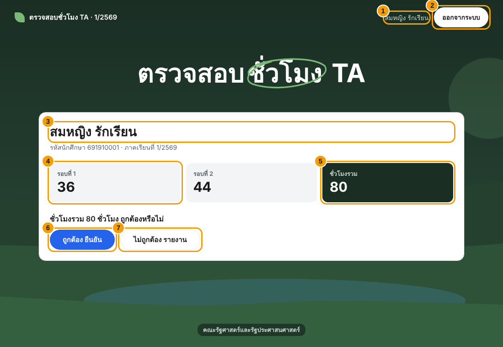

| เลข | อะไร | ทำอะไรได้ |
|---|---|---|
| ① | ชื่อของคุณ (มุมขวาบน) | ดูอย่างเดียว ใช้เช็กว่าล็อกอินถูกบัญชี |
| ② | **ออกจากระบบ** | กดได้ แนะนำให้กดเมื่อใช้เครื่องสาธารณะ |
| ③ | ชื่อ-สกุล รหัสนักศึกษา ภาคเรียน | ดูอย่างเดียว |
| ④ | ชั่วโมงแต่ละรอบ (รอบที่ 1, 2) | ดูอย่างเดียว |
| ⑤ | **ชั่วโมงรวม** (กล่องสีเข้ม) | ดูอย่างเดียว คือตัวเลขที่ต้องตรวจ |
| ⑥ | **ปุ่ม "ถูกต้อง ยืนยัน"** | กดได้ ถ้าชั่วโมงถูกต้อง |
| ⑦ | **ปุ่ม "ไม่ถูกต้อง รายงาน"** | กดได้ ถ้าไม่ถูกต้อง จะมีช่องให้พิมพ์รายละเอียด |

**ตรวจให้ละเอียดก่อนกด:** เทียบชั่วโมงรวมกับใบลงเวลาและตารางของคุณ

### ทางที่ 1 ชั่วโมงถูกต้อง: กด "ถูกต้อง ยืนยัน" (⑥)

ระบบบันทึกการยืนยันพร้อมวันเวลาทันที

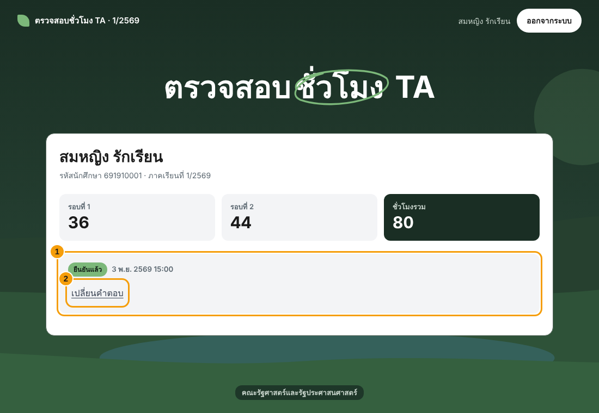

| เลข | ทำอะไรได้ |
|---|---|
| ① | **สถานะ** ป้ายสีเขียว "ยืนยันแล้ว" พร้อมวันเวลา |
| ② | **"เปลี่ยนคำตอบ"** (กดได้) กลับไปเลือกใหม่ ถ้ากดผิด |

### ทางที่ 2 ชั่วโมงไม่ถูกต้อง: กด "ไม่ถูกต้อง รายงาน" (⑦)

จะมีช่องให้บอกเจ้าหน้าที่ว่าผิดตรงไหน

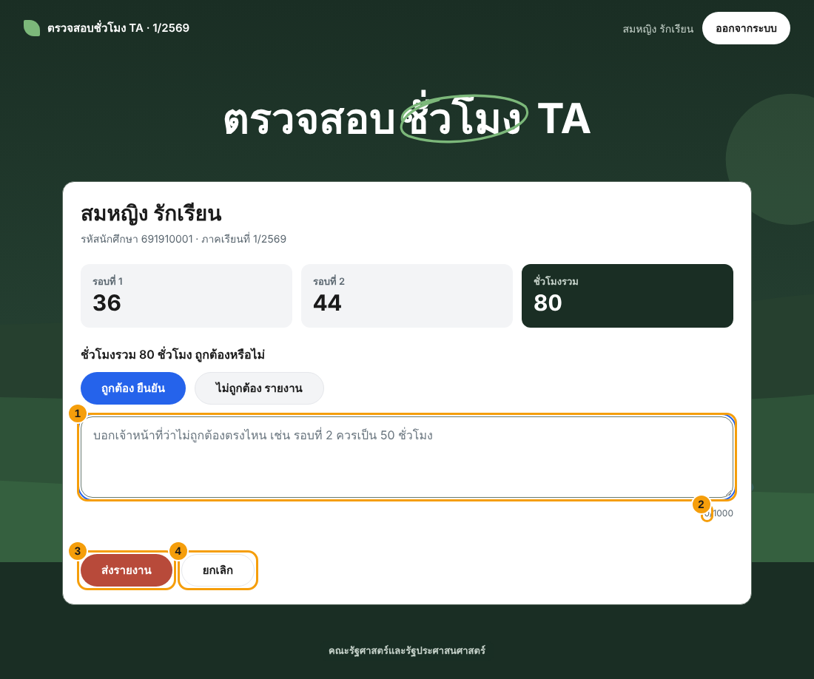

| เลข | ทำอะไรได้ |
|---|---|
| ① | **ช่องรายละเอียด (กรอกได้)** พิมพ์ว่าไม่ถูกต้องตรงไหน เช่น "รอบที่ 2 ควรเป็น 50 ชั่วโมง เพราะ..." พิมพ์ได้ไม่เกิน 1,000 ตัวอักษร |
| ② | **ตัวนับตัวอักษร** (ดูอย่างเดียว) |
| ③ | **ปุ่ม "ส่งรายงาน"** (กดได้) |
| ④ | **ปุ่ม "ยกเลิก"** (กดได้) ปิดช่องนี้โดยไม่ส่งอะไร |

**ต้องพิมพ์อย่างน้อย 10 ตัวอักษร** ถ้าสั้นเกินไปจะไม่ส่ง และขึ้นข้อความให้อธิบายเพิ่ม

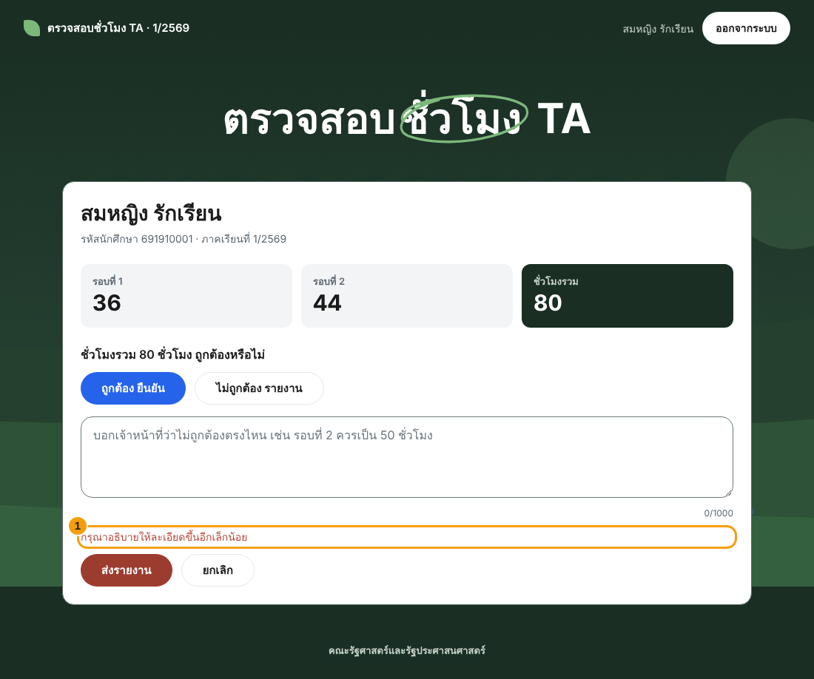

เขียนให้เจ้าหน้าที่ตรวจต่อได้ง่าย บอกรอบที่ผิด ตัวเลขที่ถูกต้องที่คุณคิดว่าควรเป็น และเหตุผลหรือวันที่ที่เกี่ยวข้อง

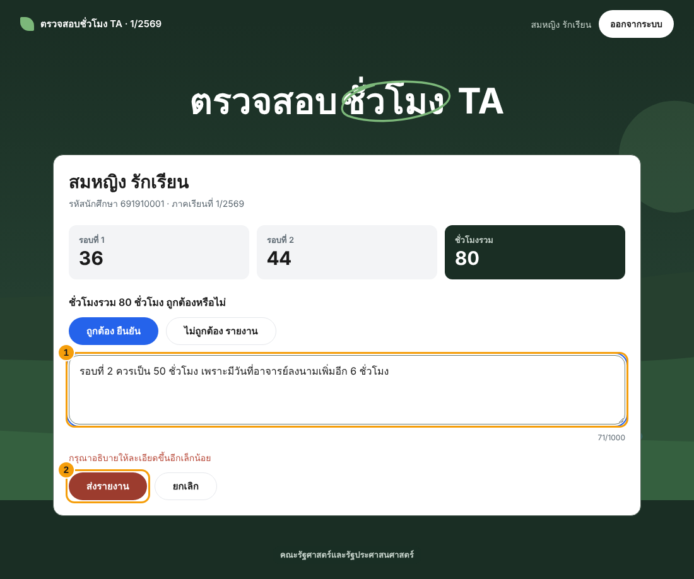

กด "ส่งรายงาน" (②) แล้วระบบส่งถึงเจ้าหน้าที่ทันที (เจ้าหน้าที่ได้รับอีเมลแจ้งเตือนด้วย)

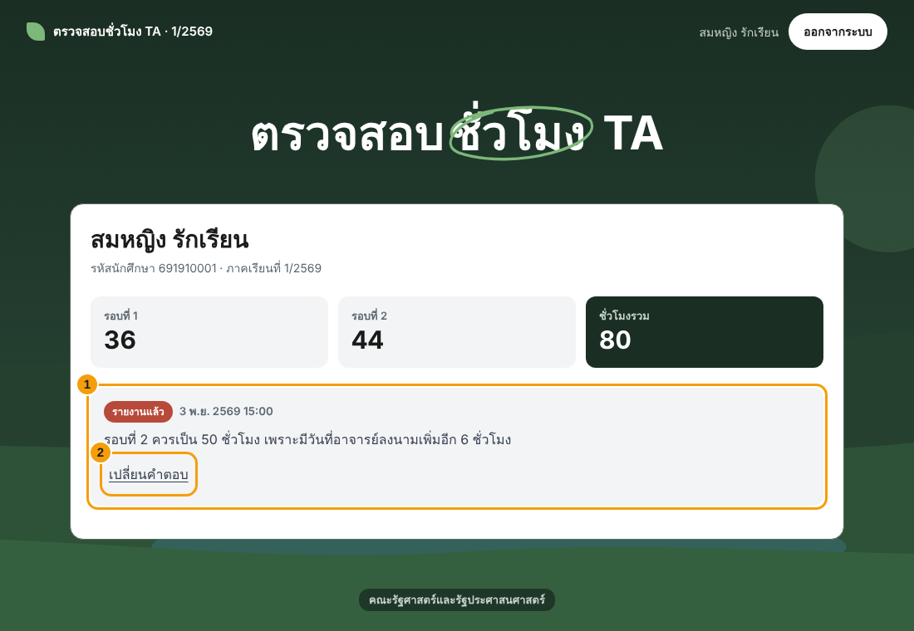

| เลข | ทำอะไรได้ |
|---|---|
| ① | **สถานะ** ป้ายสีแดง "รายงานแล้ว" พร้อมข้อความที่คุณส่ง |
| ② | **"เปลี่ยนคำตอบ"** (กดได้) ส่งรายงานใหม่หรือเปลี่ยนเป็นยืนยัน |

### เมื่อเจ้าหน้าที่แก้ชั่วโมงหลังคุณตอบแล้ว

ถ้าชั่วโมงในระบบถูกปรับ หลังจากที่คุณยืนยันหรือรายงานไปแล้ว ระบบจะแจ้งและให้ **ตอบอีกครั้ง** เมื่อกลับมาเปิดหน้านี้

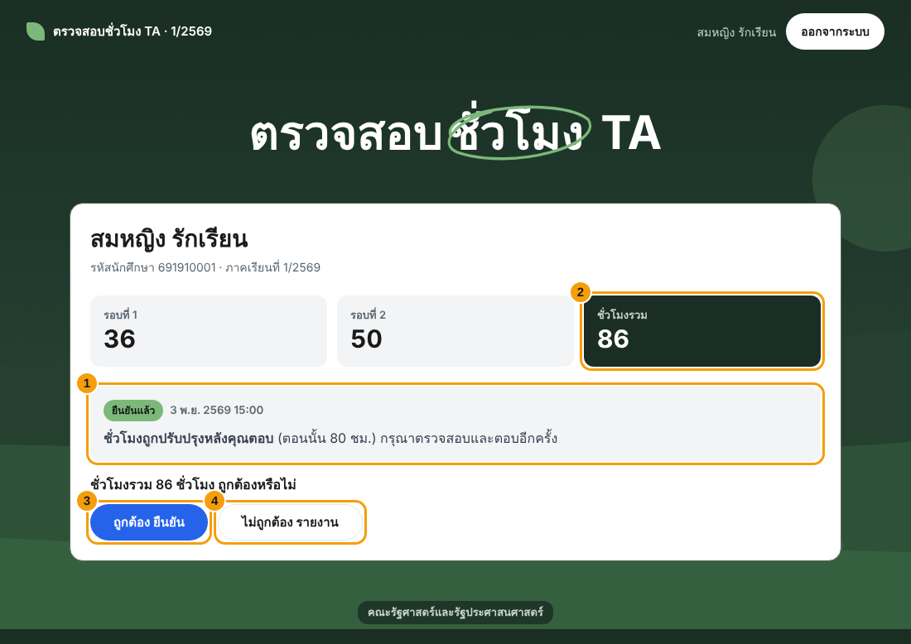

| เลข | อะไร |
|---|---|
| ① | ข้อความ "ชั่วโมงถูกปรับปรุงหลังคุณตอบ" บอกชั่วโมงเดิมที่คุณเห็น |
| ② | ชั่วโมงรวมใหม่ |
| ③ ④ | กด "ถูกต้อง ยืนยัน" หรือ "ไม่ถูกต้อง รายงาน" ได้อีกครั้ง |

### ใช้บนมือถือ

หน้าตาเหมือนกัน ปุ่มเรียงลงมา กดง่ายด้วยนิ้ว

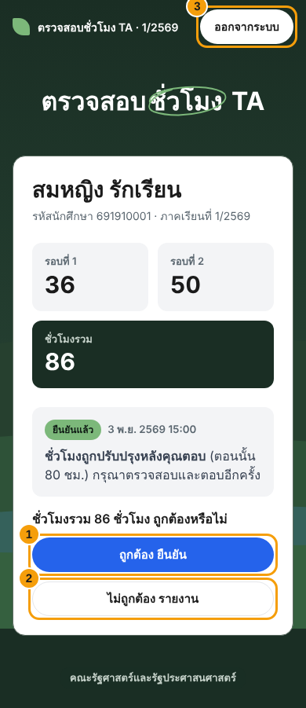

① ถูกต้อง ยืนยัน ② ไม่ถูกต้อง รายงาน ③ ออกจากระบบ

### แก้ปัญหาที่พบบ่อย (นักศึกษา)

| ข้อความ / อาการ | ทำอย่างไร |
|---|---|
| ไม่ได้รับอีเมล OTP | รอ 1–2 นาที ตรวจ Junk/Spam จากนั้นกด "ส่งรหัสใหม่" ถ้ายังไม่ได้ ตรวจว่าพิมพ์อีเมลถูกและเป็นอีเมลที่ลงทะเบียนไว้ แล้วติดต่อเจ้าหน้าที่ |
| รหัสไม่ถูกต้อง | ตรวจตัวเลขอีกครั้ง และใช้ **รหัสล่าสุดเท่านั้น** (ถ้าขอรหัสหลายครั้ง รหัสเก่าใช้ไม่ได้) |
| รหัสหมดอายุ / กรอกผิดเกินกำหนด | กด "ส่งรหัสใหม่" |
| ขอรหัสบ่อยเกินไป | รอ 1 นาทีแล้วลองใหม่ |
| ส่งอีเมลไม่สำเร็จ | กดขอรหัสใหม่อีกครั้ง ถ้ายังไม่ได้ ติดต่อเจ้าหน้าที่ |
| ระบบส่งอีเมลเต็มโควตาของวันนี้ | ลองใหม่พรุ่งนี้หรือติดต่อเจ้าหน้าที่ |
| เซสชันหมดอายุ กรุณาเข้าสู่ระบบใหม่ | ระบบให้ใช้งานต่อเนื่องได้ราว 6 ชั่วโมง แล้วต้องขอ OTP ใหม่ |
| ยังไม่มีข้อมูลชั่วโมงของคุณในภาคเรียนนี้ | แจ้งเจ้าหน้าที่ ชื่อของคุณอาจยังไม่ถูกนำเข้า |

---

## ส่วนที่ 2 สำหรับเจ้าหน้าที่

เจ้าหน้าที่ใช้ลิงก์เดียวกับนักศึกษา และ **ล็อกอินด้วย OTP แบบเดียวกัน** (ขั้นที่ 1–3 ข้างต้น) แต่ใช้อีเมลที่ลงไว้ในแท็บ `Staff` ของชีต เมื่อเข้าสำเร็จจะเห็น **แดชบอร์ด** แทนหน้านักศึกษา

### หน้าแดชบอร์ด

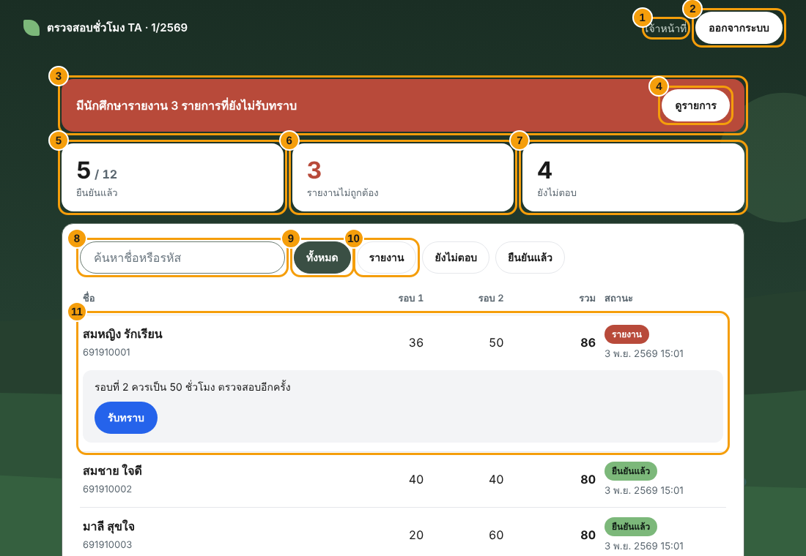

| เลข | อะไร | ทำอะไรได้ |
|---|---|---|
| ① | ชื่อผู้ใช้ (มุมขวาบน) | ดูอย่างเดียว |
| ② | **ออกจากระบบ** | กดได้ |
| ③ | **แบนเนอร์แดง** "มีนักศึกษารายงาน N รายการที่ยังไม่รับทราบ" | ดูอย่างเดียว แสดงเมื่อมีรายงานที่ยังไม่กดรับทราบ (หายไปเมื่อรับทราบครบ) |
| ④ | **ปุ่ม "ดูรายการ"** | กดได้ กรองเฉพาะรายงานไม่ถูกต้อง |
| ⑤ | **ยืนยันแล้ว** (เช่น 5 / 12) | ดูอย่างเดียว จำนวนที่ยืนยันแล้ว / นักศึกษาทั้งหมด |
| ⑥ | **รายงานไม่ถูกต้อง** | ดูอย่างเดียว (ตัวเลขสีแดงเมื่อมี) |
| ⑦ | **ยังไม่ตอบ** | ดูอย่างเดียว ใช้ตามคนที่ยังไม่ตอบ |
| ⑧ | **ช่องค้นหา (กรอกได้)** | พิมพ์ชื่อหรือรหัสนักศึกษา |
| ⑨ ⑩ | **ปุ่มกรองสถานะ** ทั้งหมด / รายงาน / ยังไม่ตอบ / ยืนยันแล้ว | กดได้ ปุ่มที่เลือกอยู่เป็นสีเขียวเข้ม |
| ⑪ | **แถวนักศึกษา** | ชื่อ รหัส ชั่วโมงรอบที่ 1, 2 ชั่วโมงรวม และป้ายสถานะพร้อมวันเวลาที่ตอบ แถวที่ "รายงาน" จะแสดงข้อความของนักศึกษาและปุ่มรับทราบ |

ป้ายสถานะ: **ยืนยันแล้ว** (เขียว) · **รายงาน** (แดง) · **ยังไม่ตอบ** (เทา) · **ชม.เปลี่ยน** (ขอบขาว) หมายถึงชั่วโมงถูกแก้หลังนักศึกษาตอบ

หน้านี้ **รีเฟรชข้อมูลอัตโนมัติทุก 1 นาทีขณะเปิดแท็บนี้อยู่** (และรีเฟรชทันทีเมื่อสลับกลับมาที่แท็บ) ตัวเลขรายงานใหม่จะแสดงบนชื่อแท็บเบราว์เซอร์ด้วย เช่น `(3) ตรวจสอบชั่วโมง TA` ทำให้เห็นได้แม้เปิดหน้าไว้ข้างหลัง

หน้าทั้งหมดต่อเนื่องลงมา (รายชื่อนักศึกษาทุกคน):

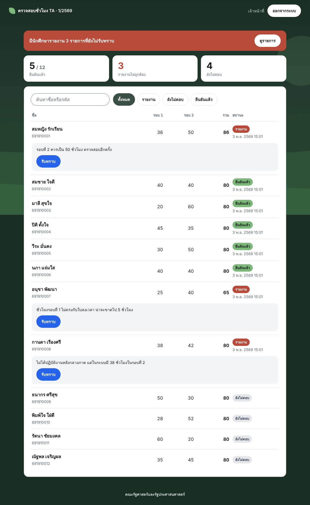

### ดูและรับทราบรายงาน

กด "ดูรายการ" (④) หรือปุ่มกรอง "รายงาน" เพื่อดูเฉพาะรายงาน

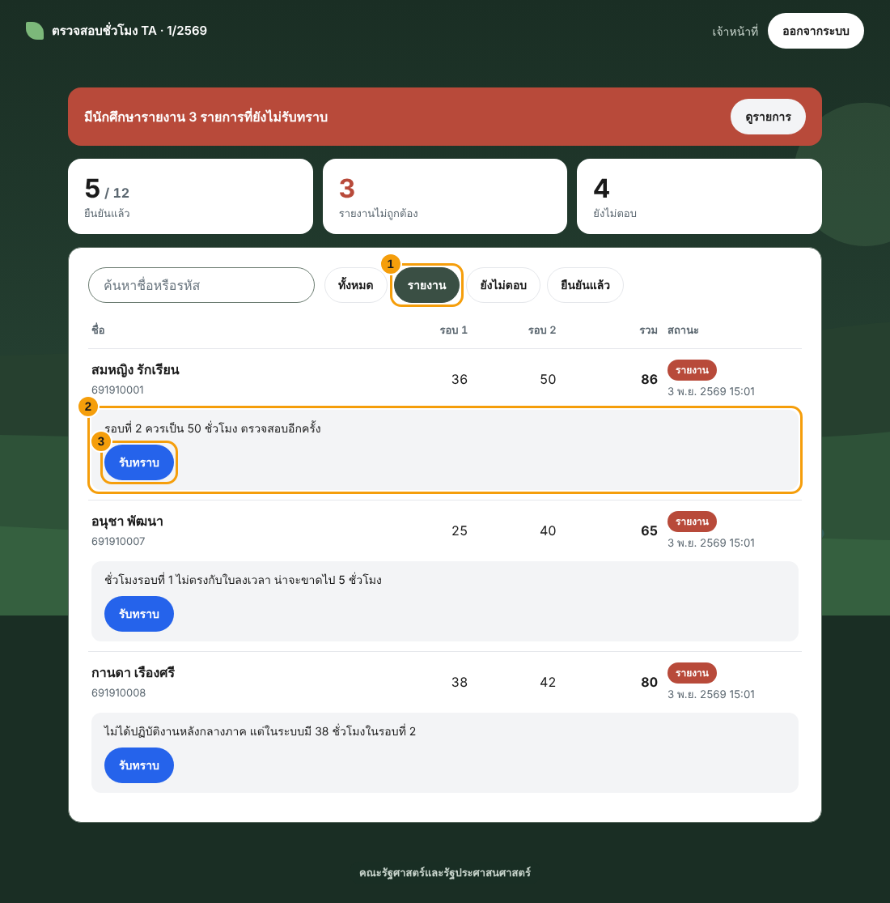

| เลข | ทำอะไรได้ |
|---|---|
| ① | **ปุ่มกรอง "รายงาน"** กดแล้วเห็นเฉพาะคนที่รายงาน |
| ② | **ข้อความจากนักศึกษา** (ดูอย่างเดียว) อ่านรายละเอียดว่าผิดตรงไหน |
| ③ | **ปุ่ม "รับทราบ"** (กดได้) กดเมื่อคุณเห็นและดำเนินการแล้ว |

หลังกด "รับทราบ" ปุ่มเปลี่ยนเป็นข้อความ "รับทราบแล้ว" และแบนเนอร์ลดจำนวนลง (เมื่อรับทราบครบ แบนเนอร์หายไป)

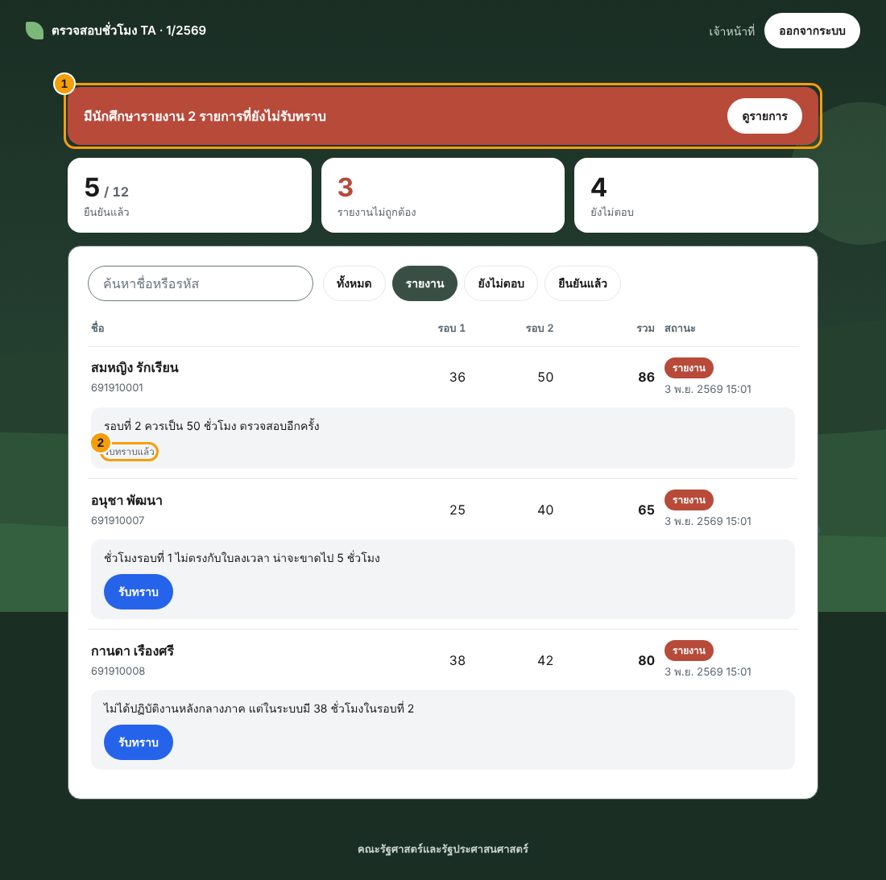

① แบนเนอร์ลดจำนวนลง ② ข้อความ "รับทราบแล้ว"

**สิ่งที่ควรทำเมื่อมีรายงาน**
1. อ่านข้อความของนักศึกษา แล้วตรวจกับเอกสารต้นฉบับ
2. ถ้าต้องแก้ชั่วโมง ให้แก้ที่แท็บ `Hours` ในชีต (ช่อง `hours` ของแถวนั้น) ระบบจะแสดงป้าย "ชม.เปลี่ยน" และให้นักศึกษาตอบใหม่
3. กด "รับทราบ" เพื่อบอกทีมว่ารายการนี้มีคนดูแล

### ค้นหาและกรอง

พิมพ์ในช่องค้นหา (①) ผลจะแสดงทันที ค้นได้ทั้งชื่อและรหัส

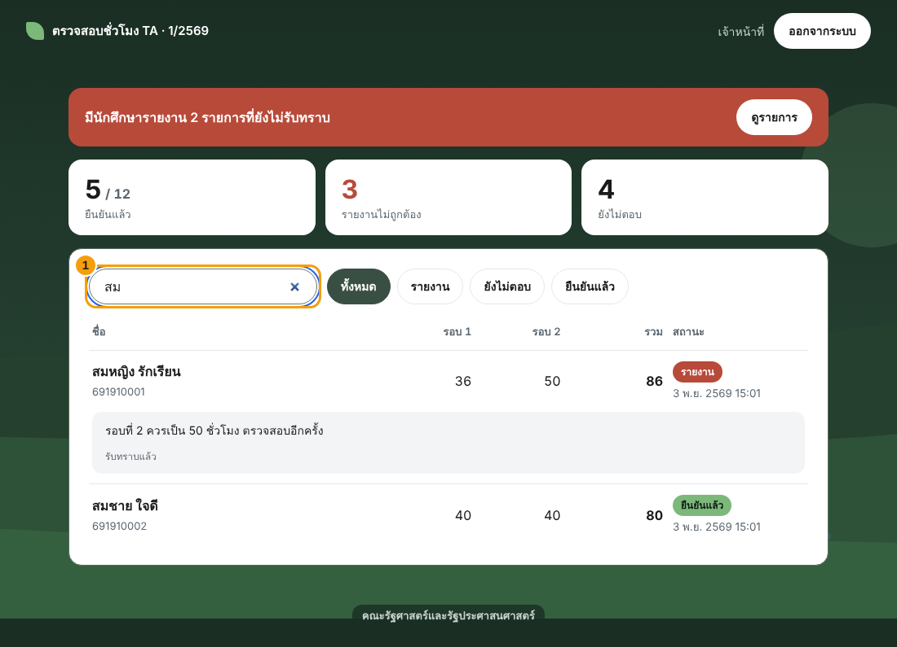

กดปุ่มกรอง "ยังไม่ตอบ" เพื่อดูรายชื่อที่ต้องติดตาม

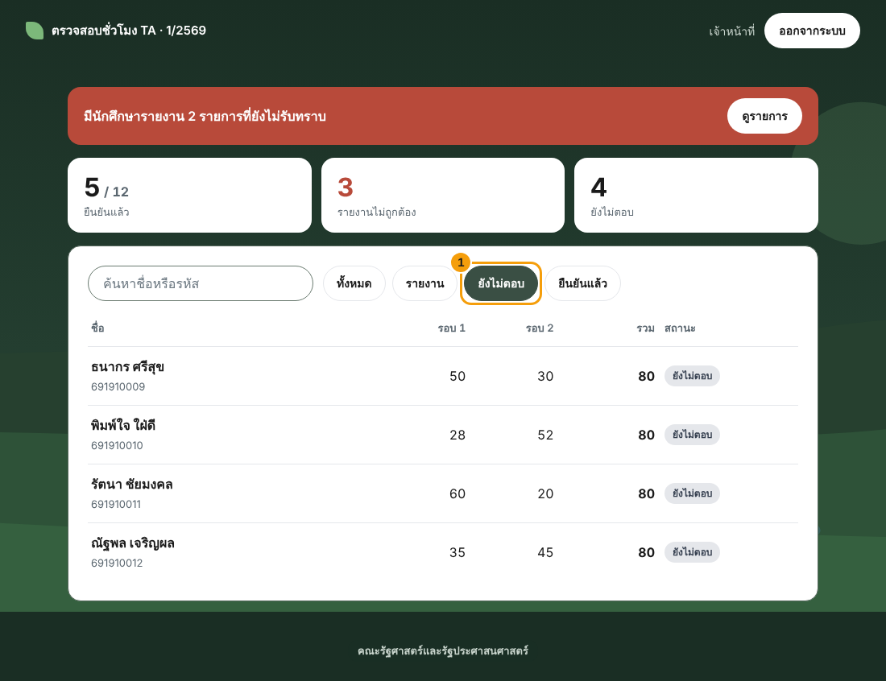

ปุ่มกรองและช่องค้นหาใช้ร่วมกันได้ เช่น กรอง "ยังไม่ตอบ" แล้วพิมพ์ชื่อ

### ใช้บนมือถือ

แถวรายชื่อเรียงต่อกันเป็นการ์ด ใช้งานได้ครบเหมือนบนคอมพิวเตอร์

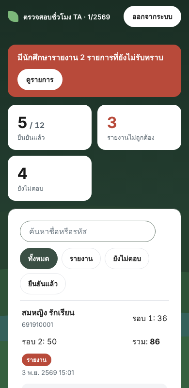

### อีเมลแจ้งเตือนเมื่อมีรายงาน

เมื่อนักศึกษากด "ส่งรายงาน" ระบบส่งอีเมลถึง **เจ้าหน้าที่ทุกคนในแท็บ `Staff`** หัวเรื่องแบบนี้

> `[TA 1/2569] นักศึกษารายงานชั่วโมงไม่ถูกต้อง: สมหญิง รักเรียน (691910001)`

เนื้อหาบอกชื่อ รหัส ชั่วโมงรวมในระบบ ข้อความของนักศึกษา และลิงก์เปิดระบบ (ปิดการแจ้งเตือนทางอีเมลได้โดยตั้งค่า `NOTIFY_EMAIL` เป็น `FALSE` ในแท็บ `Config`)

### งานของผู้ดูแลในชีต (ไม่ต้องแก้โค้ด)

| ต้องการ | ทำที่ไหน |
|---|---|
| เพิ่ม/ลบเจ้าหน้าที่ | แท็บ `Staff` เพิ่มแถวอีเมลและชื่อ (มีผลทันที) |
| แก้ชั่วโมงนักศึกษา | แท็บ `Hours` (หนึ่งแถวต่อคนต่อรอบ) |
| เปลี่ยนภาคเรียน | แท็บ `Config` แก้ค่า `TERM` แล้วนำเข้าข้อมูลภาคใหม่ |
| ดูประวัติการตอบ | แท็บ `Response` (บันทึกทุกครั้งที่นักศึกษากดยืนยัน/รายงาน) |
| ดูว่าใครรับทราบรายงาน | แท็บ `Ack` |
| ปรับเวลาหมดอายุ OTP / จำนวนครั้งที่กรอกผิดได้ / จำนวนตัวอักษรขั้นต่ำของรายงาน | แท็บ `Config` |

### แก้ปัญหาที่พบบ่อย (เจ้าหน้าที่)

| อาการ | สาเหตุ / วิธีแก้ |
|---|---|
| ได้รับ OTP แต่เห็นหน้านักศึกษา | อีเมลนั้นไม่อยู่ในแท็บ `Staff` ให้เพิ่มแถวนั้นก่อน |
| แดชบอร์ดว่างเปล่า "ไม่พบรายการ" | ค่า `TERM` ในแท็บ `Config` ไม่ตรงกับภาคเรียนในแท็บ `Hours` หรือยังไม่นำเข้าข้อมูล |
| นักศึกษาบอกไม่ได้รับ OTP | ตรวจว่าอีเมลของเขาในแท็บ `Student` ถูกต้องและเป็น @cmu.ac.th ให้เขากดส่งรหัสใหม่ และตรวจ Junk |
| ส่งอีเมลไม่ได้ทั้งระบบ | อาจเต็มโควตาอีเมลของวัน (ระบบจะแจ้งข้อความนี้) รอวันถัดไป |
| รายงานมาแล้วแต่ไม่ได้อีเมล | ตรวจ `NOTIFY_EMAIL` ใน `Config` และโฟลเดอร์ Junk ของเจ้าหน้าที่ ข้อมูลรายงานยังอยู่ในแดชบอร์ดและแท็บ `Response` |
